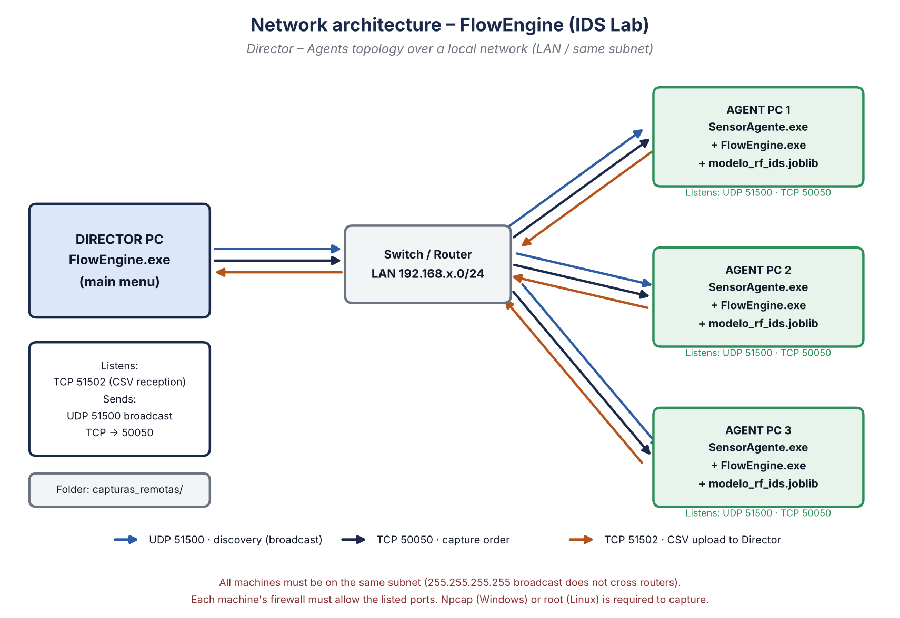

# FlowEngine — IDS Dataset Generator

[](https://doi.org/10.5281/zenodo.23932954)

[🇪🇸 Español](README.md) · 🇬🇧 English

Python tool that **captures network traffic, turns it into flows (91 columns, 64 of them numeric features) and labels them** (manually or with a Random Forest model), built to train and evaluate **Intrusion Detection Systems (IDS)**. Includes a **distributed** mode to capture from several LAN machines at once, the model training script and the lab's attack-traffic generator.



## Features

- 📡 **Live capture** with Scapy (Windows with Npcap, Linux as root).
- 🏷️ **Live manual labelling**: type the label while capturing; every change is logged with its exact timestamp.
- 🤖 **Automatic AI labelling** (`modelo_rf_ids.joblib`, scikit-learn) plus the script to train it.
- 📂 **Processing of existing PCAP/PCAPNG files**.
- 🔍 **Wireshark-style filters** (`tcp.port == 80`, `ip.src == '…'`, `&&`, `||`) and derived variables.
- 🌐 **Distributed capture** Director → Agents (immediate or scheduled) with automatic CSV upload, protected by a token.
- 🧬 Each flow has **91 columns**: identification (IPs, ports, protocol, timestamps), **64 numeric features** used by the model, and the label. They cover timing, size, TCP flag, TLS (SNI, **JA3**), DNS, HTTP, entropy and UNSW-NB15-style context features.
- 📊 **232,515 raw labelled lab flows** (normal, dos, portscan, bruteforce, fuzzer, beaconing, injection); **223,763** remain usable for training after cleaning (duplicate removal and removal of rows with null or infinite values). Published on [Zenodo](https://doi.org/10.5281/zenodo.23932954).

## Quick start

```bash
git clone https://github.com/AndresR26/FlowEngine.git
cd FlowEngine
pip install -r requirements.txt

cd src
python flow_engine.py          # Windows: Administrator console · Linux: sudo
python compilar.py             # builds FlowEngine.exe and SensorAgente.exe in src/dist/
```

Train the model on the datasets (download them from [Zenodo](https://doi.org/10.5281/zenodo.23932954) first and unzip into `datasets/`):

```bash
python training/entrenar_modelo.py --datos datasets --salida training/modelo_salida
```

## Documentation

| Document | English | Español | PDF |
|---|---|---|---|
| Technical manual (includes network architecture) | [technical_manual.md](docs/en/technical_manual.md) | [manual_tecnico.md](docs/es/manual_tecnico.md) | [EN](docs/pdf/Technical_Manual_FlowEngine_EN.pdf) · [ES](docs/pdf/Manual_Tecnico_FlowEngine_ES.pdf) |
| User manual | [user_manual.md](docs/en/user_manual.md) | [manual_usuario.md](docs/es/manual_usuario.md) | [EN](docs/pdf/User_Manual_FlowEngine_EN.pdf) · [ES](docs/pdf/Manual_Usuario_FlowEngine_ES.pdf) |
| Network architecture | [Technical manual §5](docs/en/technical_manual.md#5-network-architecture) | [Manual técnico §5](docs/es/manual_tecnico.md#5-arquitectura-de-red) | |

## Repository layout

```text
FlowEngine/
├── src/            Main program (flow_engine, live_conf, pcap_conf, filters, network, agent, build)
├── training/       entrenar_modelo.py → modelo_rf_ids.joblib
├── tools/          etiquetar_con_ground_truth.py · generar_diagramas.py · build_pdfs.sh
├── lab/            lab_attacks.sh — attack traffic for the isolated lab
├── legacy/         Earlier versions no longer used
├── datasets/       README with statistics (CSV/PCAP files are on Zenodo)
├── models/         README (the .joblib goes to GitHub Releases)
├── installers/     README with Npcap and Nmap links
└── docs/           ES/EN manuals, diagrams (img/) and PDFs
```

## Network ports

| Port | Protocol | Listening machine | Purpose |
|---|---|---|---|
| 51500 | UDP | Agent | Discovery (broadcast) |
| 50050 | TCP | Agent | Capture orders |
| 51502 | TCP | Director | CSV reception |

Set the same token on every machine with a `token_red.txt` file next to the program or the `FLOWENGINE_TOKEN` variable (see [technical manual §5.2](docs/en/technical_manual.md#52-ports-and-protocols)).

## Data (Zenodo)

The labelled CSVs and the lab's PCAP captures are published on **Zenodo** (this record holds the data only, not the code):

**DOI: [10.5281/zenodo.23932954](https://doi.org/10.5281/zenodo.23932954)**

| Content | Detail |
|---|---|
| Labelled CSVs | 12 files · 91 columns · 232,515 raw flows (223,763 usable) |
| PCAP | Raw lab traffic (≈1.6 GB) |

The `modelo_rf_ids.joblib` model and the compiled executables are published on **GitHub Releases**.

## How to cite

> Restrepo, A. (2026). *FlowEngine: network-traffic dataset generator for IDS* [Dataset]. Zenodo. https://doi.org/10.5281/zenodo.23932954

## Responsible use

This software and `lab/lab_attacks.sh` are meant for **labs and networks you own or are authorised to test**. Capturing third-party traffic or launching attacks without permission may be illegal.

## Author

**Andres Restrepo** — [@AndresR26](https://github.com/AndresR26)

## License

[MIT](LICENSE)
