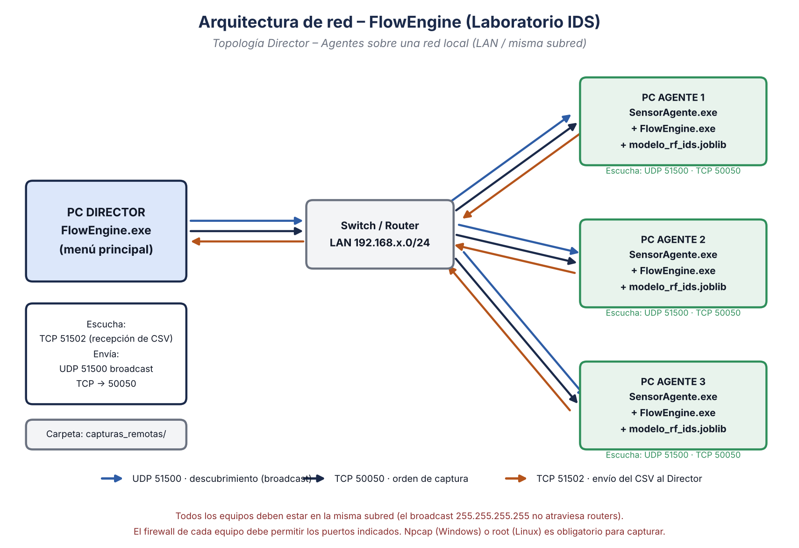

# FlowEngine — Generador de Datasets para IDS

[](https://doi.org/10.5281/zenodo.XXXXXXX)

🇪🇸 Español · [🇬🇧 English](README.en.md)

Herramienta en Python para **capturar tráfico de red, convertirlo en flujos (91 columnas, 64 de ellas características numéricas) y etiquetarlo** (a mano o con un modelo Random Forest), pensada para entrenar y evaluar **Sistemas de Detección de Intrusiones (IDS)**. Incluye un modo **distribuido** para capturar desde varios equipos de la LAN a la vez, el script de entrenamiento del modelo y el generador de tráfico de ataque del laboratorio.



## Características

- **Captura en vivo** con Scapy (Windows con Npcap, Linux con root).
- **Etiquetado manual en vivo**: escribe la etiqueta mientras captura; cada cambio queda registrado con su hora exacta.
- **Etiquetado automático con IA** (`modelo_rf_ids.joblib`, scikit-learn) y script para entrenarlo.
- **Procesamiento de archivos PCAP/PCAPNG** existentes.
- **Filtros estilo Wireshark** (`tcp.port == 80`, `ip.src == '…'`, `&&`, `||`) y variables derivadas.
- **Captura distribuida** Director → Agentes (inmediata o programada) con envío automático del CSV, protegida por token.
- Cada flujo tiene **91 columnas**: identificación (IPs, puertos, protocolo, horas), **64 características numéricas** usadas por el modelo y la etiqueta. Incluyen tiempo, tamaño, flags TCP, TLS (SNI, **JA3**), DNS, HTTP, entropía y contexto tipo UNSW-NB15.
- **232 515 flujos etiquetados en bruto** de laboratorio (normal, dos, portscan, bruteforce, fuzzer, beaconing, injection); **223 763** quedan utilizables para entrenar tras la limpieza. Publicados en [Zenodo](https://doi.org/10.5281/zenodo.XXXXXXX).

## Inicio rápido

```bash
git clone https://github.com/AndresR26/FlowEngine.git
cd FlowEngine
pip install -r requirements.txt

cd src
python flow_engine.py          # Windows: consola como Administrador · Linux: sudo
python compilar.py             # genera FlowEngine.exe y SensorAgente.exe en src/dist/
```

Entrenar el modelo con los datasets (descárgalos antes de [Zenodo](https://doi.org/10.5281/zenodo.XXXXXXX) y descomprímelos en `datasets/`):

```bash
python training/entrenar_modelo.py --datos datasets --salida training/modelo_salida
```

## Documentación

| Documento | Español | English | PDF |
|---|---|---|---|
| Manual técnico (incluye arquitectura de red) | [manual_tecnico.md](docs/es/manual_tecnico.md) | [technical_manual.md](docs/en/technical_manual.md) | [ES](docs/pdf/Manual_Tecnico_FlowEngine_ES.pdf) · [EN](docs/pdf/Technical_Manual_FlowEngine_EN.pdf) |
| Manual de usuario | [manual_usuario.md](docs/es/manual_usuario.md) | [user_manual.md](docs/en/user_manual.md) | [ES](docs/pdf/Manual_Usuario_FlowEngine_ES.pdf) · [EN](docs/pdf/User_Manual_FlowEngine_EN.pdf) |
| Arquitectura de red | [Manual técnico §5](docs/es/manual_tecnico.md#5-arquitectura-de-red) | [Technical manual §5](docs/en/technical_manual.md#5-network-architecture) | |

## Estructura del repositorio

```text
FlowEngine/
├── src/            Programa principal (flow_engine, live_conf, pcap_conf, filtros, red, agente, compilar)
├── training/       entrenar_modelo.py → modelo_rf_ids.joblib
├── tools/          etiquetar_con_ground_truth.py · generar_diagramas.py · build_pdfs.sh
├── lab/            lab_attacks.sh — tráfico de ataque para el laboratorio aislado
├── legacy/         Versiones anteriores que ya no se usan
├── datasets/       README con estadísticas (los CSV/PCAP están en Zenodo)
├── models/         README (el .joblib va en GitHub Releases)
├── installers/     README con enlaces a Npcap y Nmap
└── docs/           Manuales ES/EN, diagramas (img/) y PDF
```

## Puertos de red

| Puerto | Protocolo | Equipo que escucha | Uso |
|---|---|---|---|
| 51500 | UDP | Agente | Descubrimiento (broadcast) |
| 50050 | TCP | Agente | Órdenes de captura |
| 51502 | TCP | Director | Recepción de CSV |

Configura el mismo token en todos los equipos con un archivo `token_red.txt` junto al programa o con la variable `FLOWENGINE_TOKEN` (ver [manual técnico §5.2](docs/es/manual_tecnico.md#52-puertos-y-protocolos)).

## Datos (Zenodo)

Los CSV etiquetados y las capturas PCAP del laboratorio están publicados en **Zenodo**:

**DOI: [10.5281/zenodo.XXXXXXX](https://doi.org/10.5281/zenodo.XXXXXXX)**

| Contenido | Detalle |
|---|---|
| CSV etiquetados | 12 archivos · 91 columnas · 232 515 flujos en bruto (223 763 utilizables) |
| PCAP | Tráfico crudo del laboratorio (≈1,6 GB) |

El modelo `modelo_rf_ids.joblib` y los ejecutables compilados se publican en **GitHub Releases**.

## Cómo citar

> Restrepo, A. (2026). *FlowEngine: generador de datasets de tráfico de red para IDS* [Conjunto de datos y software]. Zenodo. https://doi.org/10.5281/zenodo.XXXXXXX

## Uso responsable

Este software y `lab/lab_attacks.sh` son para **laboratorios y redes propias o autorizadas**. Capturar tráfico de terceros o lanzar ataques sin permiso puede ser ilegal.

## Autor

**Andres Restrepo** — [@AndresR26](https://github.com/AndresR26)

## Licencia

[MIT](LICENSE)
