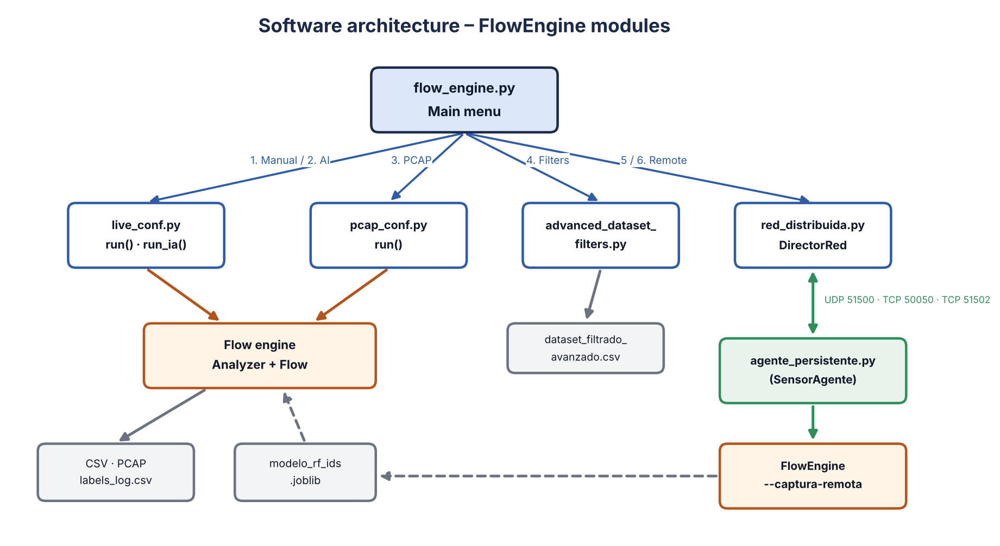
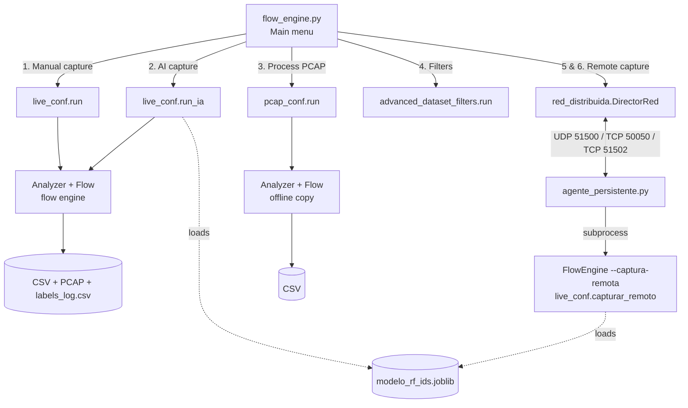
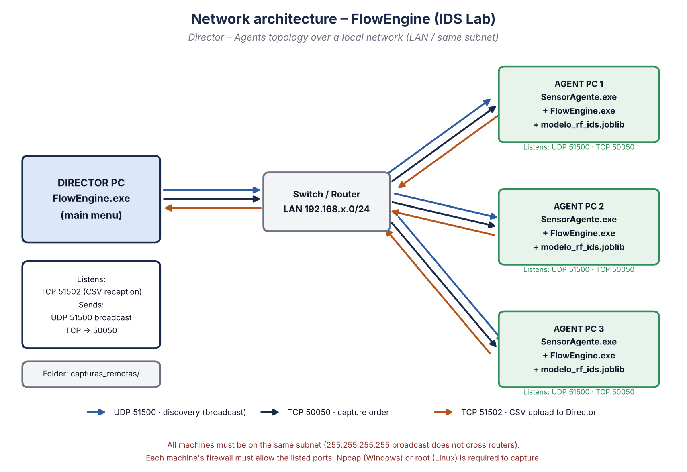
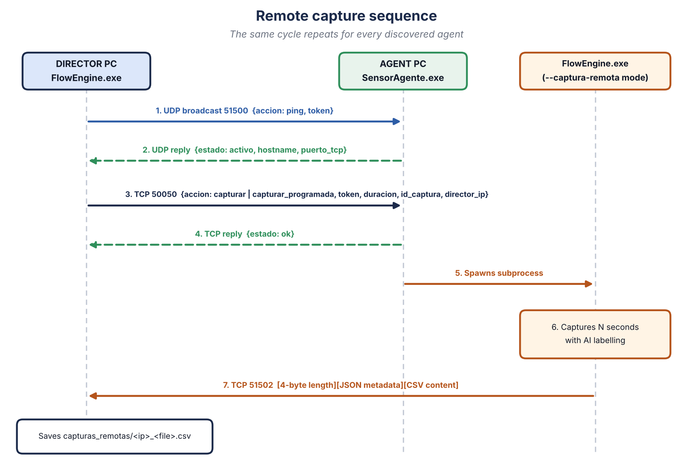
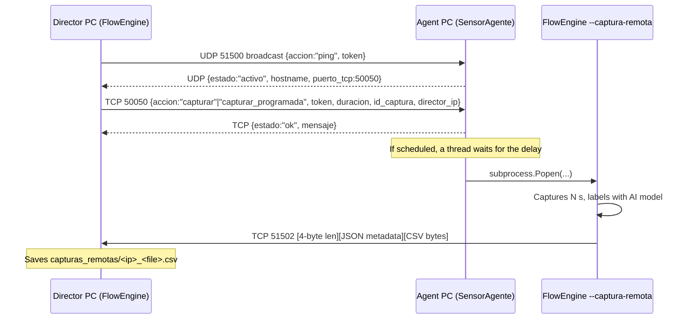

# Technical Manual — FlowEngine (IDS Dataset Generator)

> **Document version:** 1.1 · **Date:** November 2026  
> **Versión en español:** [../es/manual_tecnico.md](../es/manual_tecnico.md)

---

## Table of contents

1. [Introduction](#1-introduction)
2. [System requirements](#2-system-requirements)
3. [Project structure](#3-project-structure)
4. [Software architecture](#4-software-architecture)
5. [Network architecture](#5-network-architecture)
6. [Module reference](#6-module-reference)
7. [Flow engine](#7-flow-engine)
8. [CSV data dictionary](#8-csv-data-dictionary)
9. [AI model integration](#9-ai-model-integration)
10. [Configuration parameters](#10-configuration-parameters)
11. [Generated files](#11-generated-files)
12. [Build and deployment](#12-build-and-deployment)
13. [Security](#13-security)
14. [Known issues and recommended improvements](#14-known-issues-and-recommended-improvements)
15. [Troubleshooting](#15-troubleshooting)
16. [Companion tools](#16-companion-tools)

> Identifiers, menu text and console messages are kept in Spanish, exactly as they appear in the source code.

---

## 1. Introduction

**FlowEngine** is a Python console tool that **generates network-traffic datasets** for training and evaluating Intrusion Detection Systems (IDS). It:

- Captures live traffic (or reads `.pcap/.pcapng` files) with **Scapy**.
- Groups packets into **bidirectional flows** and produces **91 columns** per flow, **64 of them numeric features** (size and timing statistics, TCP flags, TLS/JA3, DNS, HTTP, entropy, etc.).
- Labels each flow **manually** (the operator types the label live) or **automatically** with a pre-trained **Random Forest** model (`modelo_rf_ids.joblib`).
- Lets you **filter and derive variables** on the resulting dataset.
- Supports **distributed capture**: a *Director* PC discovers agents (sensors) on the LAN, orders them to capture (immediately or scheduled) and receives the resulting CSV files.

### 1.1 Executables

| Executable | Source | Role |
|---|---|---|
| `FlowEngine.exe` | `flow_engine.py` (+ modules) | Main menu application. Used interactively on the **Director**; launched in `--captura-remota` mode on **agents**. |
| `SensorAgente.exe` | `agente_persistente.py` | Window-less resident service that listens for network orders and starts captures. Only used on **agent** machines. |

---

## 2. System requirements

### 2.1 Operating system

| OS | Support | Additional requirements |
|---|---|---|
| Windows 10/11 (64-bit) | Primary | **Npcap** installed in *WinPcap API-compatible* mode. Nmap optional. Run as Administrator. |
| Linux (Debian/Ubuntu) | Supported | Run with `sudo` (root). `tcpdump` and `nmap` (auto-installed via `apt-get`). |

### 2.2 Development software

| Component | Recommended version | Purpose |
|---|---|---|
| Python | 3.10 – 3.12 | Interpreter |
| scapy | ≥ 2.5 | Packet capture and dissection |
| numpy | ≥ 1.24 | Flow statistics |
| pandas | ≥ 2.0 | Advanced filters and model feature alignment |
| scikit-learn | **same version used to train the model** | Random Forest prediction |
| joblib | ≥ 1.3 | Model loading |
| cryptography | ≥ 41 | Required by Scapy's TLS layers |
| tkinter | bundled with Python | File/folder picker dialogs |
| PyInstaller | ≥ 6.0 | Building executables |

> ⚠️ The `.joblib` model must be loaded with the **same scikit-learn version** it was trained with; otherwise it may fail or predict incorrectly.

### 2.3 Automatic dependency installation

When run as a script (`.py`), `instalar_dependencias_python()` checks every library with `importlib.util.find_spec` and installs missing ones with `pip`. In the compiled executable (`sys.frozen`) this step is skipped because libraries are bundled.

`check_and_install_tools()` checks system tools:

- **Windows:** looks for `C:\Windows\System32\Npcap` and `C:\Program Files (x86)\Nmap\nmap.exe`. If missing, runs `npcap-1.88.exe` / `nmap-7.99-setup.exe` located **next to the executable**.
- **Linux:** requires root (`os.geteuid() == 0`) and installs `nmap` and `tcpdump` with `apt-get` if absent.

---

## 3. Project structure

```text
FlowEngine/
├── src/                          # Main program (all .py files together)
│   ├── flow_engine.py            # Entry point: main menu and --captura-remota mode
│   ├── live_conf.py              # Live capture (manual / AI / remote) + flow engine
│   ├── pcap_conf.py              # Offline PCAP processing (same engine)
│   ├── advanced_dataset_filters.py  # Filters and derived variables on a CSV
│   ├── red_distribuida.py        # Director side: discovery, orders, reception
│   ├── agente_persistente.py     # Agent side: UDP/TCP service that starts captures
│   └── compilar.py               # PyInstaller build
├── training/
│   └── entrenar_modelo.py        # Trains modelo_rf_ids.joblib (Random Forest)
├── reproducibility/              # Rebuilds the papers' numbers and figures
├── tools/
│   ├── etiquetar_con_ground_truth.py  # Labels a CSV with the UNSW-NB15 ground truth
│   ├── generar_diagramas.py      # Regenerates docs/img diagrams
│   └── build_pdfs.sh             # Regenerates docs/pdf
├── lab/
│   └── lab_attacks.sh            # Attack-traffic generator for the lab
├── legacy/                       # Earlier versions no longer used
├── datasets/ · models/ · installers/   # README only: data on Zenodo; model on GitHub Releases
└── docs/                         # ES/EN manuals, diagrams and PDFs
```

The `src/` modules must live **in the same folder**: `flow_engine.py` imports them directly (`import live_conf`, …) and `compilar.py` looks for files in the current directory.

---

## 4. Software architecture



<details>
<summary>Mermaid source (editable)</summary>



</details>

### 4.1 `flow_engine.py` execution modes

| Mode | How it is triggered | What it does |
|---|---|---|
| Interactive | `FlowEngine.exe` with no arguments | `check_and_install_tools()` → `preparar_red_distribuida()` (opens TCP 51502 receiver) → `menu_principal()` |
| Remote capture | `FlowEngine.exe --captura-remota --duracion N --id ID --director-ip IP` | Invoked by the agent. Runs `red_distribuida.ejecutar_captura_y_reportar()` with `live_conf.capturar_remoto` and uploads the CSV to the Director. |

### 4.2 Concurrency model

| Thread | Where | Function |
|---|---|---|
| Sniffer (main) | `Analyzer.run()` | `scapy.sniff(prn=Analyzer.process)` |
| Keyboard | `input_listener()` | Changes current label or stops (`stop`/`salir`) |
| Reaper | `Analyzer._reaper_loop()` | Every 5 s closes flows idle > `flow_timeout` |
| Auto-stop | `capturar_remoto.auto_stop()` | Stops a remote capture after `duracion` seconds |
| TCP receiver | `DirectorRed.iniciar_receptor_reportes()` | Server on 51502; one thread per received file |
| Agent UDP / TCP | `agente_persistente.py` | Discovery thread + command server; one thread per connection |

The shared `Analyzer.flows` dictionary is protected by `threading.Lock()`.

---

## 5. Network architecture

### 5.1 Topology



The system follows a **Director – Agents** model on a **single local network**:

- **Director PC:** runs `FlowEngine.exe` interactively. Discovers agents, sends orders and stores incoming CSV files in `capturas_remotas/`.
- **Agent (sensor) PC:** runs `SensorAgente.exe` in the background. `FlowEngine.exe` and `modelo_rf_ids.joblib` must sit next to it.

### 5.2 Ports and protocols

| Port | Protocol | Listens on | Direction | Purpose |
|---|---|---|---|---|
| **51500** | UDP | Agent (`0.0.0.0`) | Director → broadcast `255.255.255.255` | Agent discovery (ping / reply) |
| **50050** | TCP | Agent (`0.0.0.0`) | Director → Agent | Capture orders (immediate or scheduled) |
| **51502** | TCP | Director (`0.0.0.0`) | Agent → Director | Upload of the resulting CSV |

Constants defined in `red_distribuida.py` and `agente_persistente.py`:

```python
PUERTO_UDP_DESCUBRIMIENTO     = 51500
PUERTO_TCP_COMANDOS           = 50050   # agente_persistente.py
PUERTO_TCP_RECEPCION_REPORTES = 51502   # red_distribuida.py
TOKEN_RED                     = _cargar_token_red()
CARPETA_CAPTURAS_REMOTAS      = "capturas_remotas"
```

**Network token.** `_cargar_token_red()` (present in both modules) looks for it in this order:

1. Environment variable `FLOWENGINE_TOKEN`.
2. File `token_red.txt` next to the program (`.py` or `.exe`), token on the first line.
3. Default `MI_TOKEN_SECRETO_123` (public; testing only).

The Director and **every** agent must use the same token.

### 5.3 Remote capture sequence



<details>
<summary>Mermaid source (editable)</summary>



</details>

### 5.4 Message formats

**Discovery (Director → broadcast, UDP 51500):**
```json
{"accion": "ping", "token": "MI_TOKEN_SECRETO_123"}
```

**Agent reply (UDP, unicast to Director):**
```json
{"estado": "activo", "hostname": "PC-LAB-01", "puerto_tcp": 50050}
```
The Director waits **3 s** for replies (`descubrir_agentes(tiempo_espera=3)`).

**Capture order (Director → Agent, TCP 50050):**
```json
{
  "accion": "capturar",            // or "capturar_programada"
  "token": "MI_TOKEN_SECRETO_123",
  "duracion": 60,
  "director_ip": "192.168.1.10",
  "id_captura": "prueba_01",
  "retraso_segundos": 3600,        // only for capturar_programada
  "fecha_ejecucion": "2026-11-03 20:30"
}
```

**Result transfer (Agent → Director, TCP 51502):**

| Bytes | Content |
|---|---|
| 0 – 3 | Metadata length *L*, unsigned big-endian integer (`struct.pack('>I', L)`) |
| 4 – 4+L | JSON `{"nombre_archivo": "remoto_<id>_<epoch>.csv", "tamano": <bytes>, "token": "<TOKEN_RED>"}` |
| rest | Raw CSV content, sent in 4096-byte chunks |

The Director rejects the connection if the token does not match, sanitises `nombre_archivo` (no folders or invalid characters) and stores it as `capturas_remotas/<agent_IP>_<nombre_archivo>`. If fewer bytes than announced arrive, it reports an incomplete transfer.

### 5.5 Network requirements

1. All machines on the **same subnet** (the `255.255.255.255` broadcast does not cross routers).
2. Synchronised clocks (scheduled captures compute the delay from the **Director's** clock).
3. Inbound firewall rules:

**Windows (PowerShell as Administrator):**
```powershell
# On every AGENT
New-NetFirewallRule -DisplayName "FlowEngine UDP 51500" -Direction Inbound -Protocol UDP -LocalPort 51500 -Action Allow
New-NetFirewallRule -DisplayName "FlowEngine TCP 50050" -Direction Inbound -Protocol TCP -LocalPort 50050 -Action Allow
# On the DIRECTOR
New-NetFirewallRule -DisplayName "FlowEngine TCP 51502" -Direction Inbound -Protocol TCP -LocalPort 51502 -Action Allow
```

**Linux (ufw):**
```bash
sudo ufw allow 51500/udp && sudo ufw allow 50050/tcp   # agent
sudo ufw allow 51502/tcp                                # director
```

---

## 6. Module reference

### 6.1 `flow_engine.py` — Entry point

| Function | Description |
|---|---|
| `instalar_dependencias_python()` | pip-installs missing libraries (script mode only). |
| `check_and_install_tools()` | Checks Npcap/Nmap (Windows) or root + nmap/tcpdump (Linux). |
| `preparar_red_distribuida()` | Creates `DirectorRed` and starts the TCP 51502 receiver in a daemon thread. |
| `ejecutar_modo_captura_remota()` | Parses `--captura-remota --duracion --id --director-ip`, runs capture + upload. |
| `menu_principal()` | Menu loop (options 0–6). Each option runs inside `try/except` so errors never close the program. |

### 6.2 `live_conf.py` — Live capture

| Function / class | Description |
|---|---|
| `run()` | Capture with **manual** labelling. Asks for path, CSV name and PCAP name. Defaults to `<program folder>/Capturas`. |
| `run_ia()` | Same as `run()` but loads `modelo_rf_ids.joblib` and sets `MODO_ETIQUETADO = "modelo"`. Restores manual mode at the end. |
| `capturar_remoto(duracion, ruta, id, nombre_pcap)` | Timed, non-interactive capture, always AI-labelled. Returns the CSV path. |
| `input_listener()` | Keyboard thread: new label → `flush_all_active()` + entry in `LABEL_LOG`. |
| `get_active_interface()` | Interface of the default route (`conf.route.route("0.0.0.0")`). |
| `_sanitizar_nombre_archivo()` | Strips paths and invalid characters; enforces the extension. |
| `_ruta_disponible()` | If the file exists and is locked (Excel, antivirus), uses an alternate name with a time suffix. |
| `cargar_modelo_ids()` / `_predecir_etiqueta()` | Loads and applies the model (see §9). |
| `analizar_tls_clienthello()` / `calcular_ja3()` | TLS ClientHello parser and JA3 fingerprint (MD5, GREASE values removed). |
| `_entropia()` | Shannon entropy of the payload (0–8 bits/byte). |
| `detectar_protocolo()` / `detectar_service_y_payload()` | Protocol and service classification + DNS/HTTP/TLS metadata. |
| `Flow` | Accumulates per-flow statistics and builds the CSV row (`compute()`). |
| `Analyzer` | Manages active flows, CSV/PCAP writing, reaper and label log. |

### 6.3 `pcap_conf.py` — Offline processing

Contains a copy of the engine (`Flow`, `Analyzer`, parsers) adapted to file input. `run()` opens a dialog to pick the `.pcap/.pcapng`, another for the output folder, asks for the CSV name (default `pcap_resultado1.csv`) and streams packets with `PcapReader` (the file is never loaded entirely into memory), printing progress every 10,000 packets. No output PCAP is written (`save_pcap: False`) and **the resulting CSV has no `Label` column** (there is no labelling in offline mode).

> Note: since the engine exists twice (`live_conf.py` and `pcap_conf.py`), any feature change must be mirrored in both to keep datasets comparable.

### 6.4 `advanced_dataset_filters.py` — Filters

| Function | Description |
|---|---|
| `seleccionar_dataset()` | Tkinter dialog to pick a CSV. |
| `convertir_columnas_numericas()` | Converts to numeric only the columns where **every** non-empty value is a number; text columns (`State`, `Service`, `JA3`, `HTTP *`…) are kept. |
| `traducir_filtro()` | Translates Wireshark-like syntax into `pandas.query`: `tcp`, `udp`, `&&`→`and`, `\|\|`→`or`, `ip.src`, `ip.dst`. `tcp.port == N` / `udp.port == N` means *protocol and (source or destination port) = N*, as in Wireshark (supports `== != > < >= <=`). |
| `crear_variable()` | Creates a column with `df.eval(expression)`. |
| `aplicar_filtro()` | Applies the filter and prints remaining rows. |
| `guardar_dataset()` | Saves `dataset_filtrado_avanzado.csv` next to the original CSV. |

### 6.5 `red_distribuida.py` — Director side

| Element | Description |
|---|---|
| `obtener_ip_local()` | Finds the outbound interface IP (UDP socket to 8.8.8.8, no data sent). |
| `DirectorRed.descubrir_agentes()` | UDP broadcast and 3-second reply collection. |
| `DirectorRed.enviar_orden_captura()` | Sends the JSON order over TCP (10 s timeout). |
| `DirectorRed.iniciar_receptor_reportes()` | TCP server on 51502 (`listen(10)`), one thread per connection. |
| `DirectorRed.manejar_recepcion_archivo()` | Reads length + metadata + content, validates the token, sanitises the name and stores the file. |
| `menu_captura_instantanea()` | Menu option 6. |
| `menu_programar_captura()` | Menu option 5. Validates `YYYY-MM-DD HH:MM` (24 h) and that the date is in the future. |
| `ejecutar_captura_y_reportar()` | Agent side: runs the capture and uploads the CSV (30 s timeout). |

### 6.6 `agente_persistente.py` — Agent service

- Sets the working directory to the executable's folder and logs activity to `sensor_agente.log`.
- **UDP thread (51500):** replies to `ping` messages carrying a valid token.
- **TCP server (50050):** validates the token and handles `capturar` (immediate) or `capturar_programada` (thread that waits `retraso_segundos`, then starts the capture).
- `iniciar_motor_captura()` launches `FlowEngine.exe` (Windows) or `FlowEngine` (Linux) with `--captura-remota ...` (or `python flow_engine.py ...` in script mode) with `subprocess.Popen`.
- Built with `--noconsole`: no window; stop it from Task Manager.

### 6.7 `compilar.py` — Build

Checks/installs PyInstaller, deletes `build/`, `dist/` and old `.spec` files, then builds:

| Output | PyInstaller command |
|---|---|
| `dist/FlowEngine(.exe)` | `--onefile --clean --name FlowEngine flow_engine.py` |
| `dist/SensorAgente(.exe)` | `--onefile --clean --noconsole --name SensorAgente agente_persistente.py` |

---

## 7. Flow engine

### 7.1 Flow identification

Each packet is assigned to a flow by its **5-tuple** `(source IP, destination IP, source port, destination port, protocol)`. The reverse tuple is also looked up so flows are **bidirectional** (`FWD` = direction of the first packet, `BWD` = reply).

- No IP layer: 802.11 addresses (`addr2/addr1`) or Ethernet MACs are used.
- ICMP: the echo `id` is used as a pseudo-port so separate pings between the same hosts are not merged.
- Detected protocols: `TCP`, `UDP`, `ICMP`, `ARP`, `IP`, `802.11_Beacon/Auth/Deauth/ProbeReq/Other`, `OTHER`.

### 7.2 Lifecycle (when a row is written)

A flow is closed and written to the CSV on whichever comes first:

1. It reaches `min_packets` (5) packets in total.
2. It is **terminal**: RST seen, or FIN seen in both directions.
3. It exceeds `flow_timeout` (30 s) without traffic (checked by the *reaper* every 5 s).
4. The operator **changes the label** (all active flows are closed with the previous label).
5. The capture **stops** (final flush).

> **Design note:** because a flow closes upon reaching `min_packets`, a long connection produces **several consecutive rows** (~5-packet windows) rather than one row per connection. Raise `min_packets` if you need whole-connection flows.

### 7.3 TCP state

A state is recorded per packet and `State` takes the **most frequent** one: `S0` (SYN), `S1` (SYN-ACK), `EST` (ACK), `FIN`, `RST`. For UDP/ICMP: `CON` if there was a reply, `INT` otherwise.

### 7.4 Service detection

Priority: DNS (Scapy layer) → HTTP (Scapy layer) → well-known port (the lower of both ports) → TLS by signature (`0x16`) → `other`.

Mapped ports: 21 ftp, 22 ssh, 23 telnet, 25 smtp, 53 dns, 80 http, 110 pop3, 123 ntp, 137/138 netbios, 139/445 smb, 143 imap, 443 https, 1433 mssql, 1883 mqtt, 1900 ssdp, 3306 mysql, 3389 rdp, 5432 postgresql.

### 7.5 Scan signatures

`Flag Signature` flags `null_scan` (no flags), `xmas_scan` (FIN+PSH+URG) or `fin_scan` (FIN only); otherwise `none`.

---

## 8. CSV data dictionary

| Group | Columns | Description |
|---|---|---|
| Identification | `Start Time`, `End Time`, `Source IP`, `Destination IP`, `Source Port`, `Destination Port`, `Protocol`, `State`, `Service`, `SNI` | `HH:MM:SS.ffffff` time, 5-tuple, state, service and TLS SNI |
| Volume | `Flow Duration`, `Src Bytes`, `Dst Bytes`, `Src Packets`, `Dst Packets`, `Flow Bytes/s`, `Flow Packets/s`, `Src Load`, `Dst Load`, `Bytes Per Pkt`, `Size Diff`, `Byte Ratio` | Duration (s), bytes/packets per direction and rates |
| TTL | `Src TTL`, `Dst TTL`, `Src TTL Var`, `Dst TTL Var` | TTL mean and variance per direction |
| Timing | `Sjit`, `Djit`, `Sintpkt`, `Dintpkt`, `Fwd IAT Min`, `Fwd IAT Max`, `Bwd IAT Min`, `Bwd IAT Max`, `Active Mean`, `Idle Mean` | Jitter, inter-arrival time and active/idle periods (`active_gap` = 1 s) |
| TCP handshake | `tcprtt`, `synack` | SYN→ACK and SYN→SYN-ACK (s) |
| Context (60 s window) | `ct_srv_src`, `ct_srv_dst`, `ct_dst_ltm`, `ct_src_ltm` | Count of recent flows per source/destination/service (UNSW-NB15 style) |
| TCP flags | `SYN Count`, `ACK Count`, `FIN Count`, `RST Count`, `PSH Count`, `URG Count`, `ECE Count`, `CWR Count`, `Fwd/Bwd PSH Count`, `Fwd/Bwd URG Count`, `Flag Signature` | Flag counters and scan signature |
| Sizes | `Pkt Size Mean`, `Pkt Size Var`, `First Pkt Size`, `Fwd/Bwd Pkt Len Min/Max/Mean/Std` | Packet length statistics |
| Window / retransmission | `Init Fwd Win`, `Init Bwd Win`, `Zero Window Count`, `Fwd Retrans`, `Bwd Retrans` | Initial TCP window, zero windows and retransmissions (same `seq` with payload) |
| IP | `Frag Count`, `DF Count` | Fragments and *Don't Fragment* packets |
| Content | `Payload Entropy Mean` | Mean payload entropy (≈7–8 suggests encrypted/compressed) |
| ICMP | `ICMP Type`, `ICMP Code` | First value seen |
| DNS | `DNS Qname`, `DNS Qtype`, `DNS Rcode`, `DNS Ancount`, `DNS Qname Len`, `DNS Qname Entropy` | Useful for DGA / DNS tunnelling detection |
| HTTP | `HTTP Method`, `HTTP Host`, `HTTP URI`, `HTTP User-Agent`, `HTTP Status`, `HTTP Content-Length` | Plain-text HTTP only |
| TLS | `TLS Version`, `JA3` | ClientHello version and JA3 fingerprint |
| Class | `Label` | Manual label or model prediction (absent from CSVs produced by `pcap_conf.py`) |

Non-applicable fields are left empty (not 0) so they are not mistaken for a real value.

---

## 9. AI model integration

- **File:** `modelo_rf_ids.joblib`, looked up **in the program's own folder** (the path is never asked).
- **Requirement:** the model must expose `feature_names_in_`, which happens when it is trained on a `pandas.DataFrame`.
- **Alignment:** for each flow a one-row DataFrame is built with the `feature_names_in_` columns in that order. Missing or text columns (IPs, service, …) are filled with **0**.
- **Result:** the prediction (`str`) is written to `Label`. Special values on failure: `sin_pandas`, `sin_prediccion`, `error_prediccion`.

**Training:** use [`training/entrenar_modelo.py`](../../training/entrenar_modelo.py):

```bash
python training/entrenar_modelo.py --datos datasets --salida training/modelo_salida
```

The script merges every CSV in the folder, normalises labels (`MAPA_ETIQUETAS`), drops non-numeric columns (IPs, service…), tunes hyper-parameters with `RandomizedSearchCV` (15 combinations × 3-fold stratified cross-validation) and saves:

| File | Content |
|---|---|
| `modelo_rf_ids.joblib` | Final model |
| `columnas_features.json` | List and order of the features used |
| `matriz_confusion.png` | Confusion matrix on the test set |
| `importancia_caracteristicas.png` / `.csv` | Feature importance |

Because it trains on a DataFrame whose column names match FlowEngine's output, the resulting model works directly with `_predecir_etiqueta()`.

---

## 10. Configuration parameters

`CONFIG` dictionary (in `live_conf.py` and `pcap_conf.py`):

| Key | live_conf | pcap_conf | Description |
|---|---|---|---|
| `csv_file` | `live_resultado.csv` | `pcap_resultado1.csv` | Default CSV name |
| `min_packets` | 5 | 5 | Packets needed to close a flow |
| `time_window` | 60 | 60 | Window (s) for `ct_*` features |
| `flow_timeout` | 30 | 30 | Idle time (s) before closing a flow |
| `active_gap` | 1.0 | 1.0 | Gap (s) separating active from idle periods |
| `save_pcap` | `True` | `False` | Store raw traffic in a `.pcap` |
| `pcap_file` | `captura.pcap` | — | Default PCAP name |

---

## 11. Generated files

| File | Location | Content |
|---|---|---|
| `<name>.csv` | Chosen folder (default `Capturas/`) | Flow dataset |
| `<name>.pcap` | Same | Raw traffic (written with `sync=True`, survives abrupt exits) |
| `labels_log.csv` | Same | `timestamp_unix, timestamp_legible, label` for every label change |
| `filas_no_guardadas.csv` | Same | Rows that could not be written after 5 retries (locked CSV) |
| `dataset_filtrado_avanzado.csv` | Folder of the filtered CSV | Output of option 4 |
| `capturas_remotas/<ip>_remoto_<id>_<epoch>.csv` | Director | CSV received from each agent |
| `capturas_remotas/remoto_<id>_<epoch>.pcap` | Agent | Local PCAP of the remote capture (not uploaded) |
| `sensor_agente.log` | Agent | Service log |

---

## 12. Build and deployment

### 12.1 Build

```bash
cd src
pip install -r ../requirements.txt
python compilar.py
```

Output in `src/dist/`: `FlowEngine(.exe)` and `SensorAgente(.exe)`. On Linux: `chmod +x dist/*`.

> PyInstaller does not cross-compile: build on Windows for `.exe` files and on Linux for Linux binaries.

### 12.2 Distribution bundle

**Director PC:**
```text
FlowEngine.exe
modelo_rf_ids.joblib      (optional, only for option 2)
npcap-1.88.exe            (installer, downloaded from npcap.com)
nmap-7.99-setup.exe       (optional)
token_red.txt             (recommended: same token on every machine)
```

**Agent PC:**
```text
SensorAgente.exe
FlowEngine.exe            (required: the agent launches it)
modelo_rf_ids.joblib      (required: remote capture always uses AI)
npcap-1.88.exe
token_red.txt             (recommended: same token as the Director)
```

### 12.3 Agent auto-start (optional)

- **Windows:** create a Task Scheduler task with "Run with highest privileges" and an "At log on" trigger, or put a shortcut in `shell:startup` (the user must be an administrator to capture).
- **Linux (systemd):**
```ini
# /etc/systemd/system/sensoragente.service
[Unit]
Description=FlowEngine SensorAgente
After=network-online.target
[Service]
WorkingDirectory=/opt/flowengine
ExecStart=/opt/flowengine/SensorAgente
Restart=on-failure
User=root
[Install]
WantedBy=multi-user.target
```

---

## 13. Security

| Risk | Detail | Recommendation |
|---|---|---|
| Public default token | If not configured, `MI_TOKEN_SECRETO_123` is used, visible on GitHub | ✅ Now read from `FLOWENGINE_TOKEN` or `token_red.txt` (excluded by `.gitignore`). Set it on every machine |
| Unencrypted traffic | Orders, token and CSV files travel in plain text | Use only on isolated lab networks or add TLS (`ssl` module) |
| Unauthenticated receiver | Port 51502 used to accept files from any host | ✅ Fixed: metadata carries the token and the Director validates it |
| Unsanitised file name | `nombre_archivo` comes from the client | ✅ Fixed: `_nombre_seguro()` strips folders and invalid characters |
| Elevated privileges | Capturing requires admin/root | Run only on lab machines |
| Sensitive data | PCAP/CSV files may contain real IPs, domains, URIs and user agents | Never commit real captures (see `.gitignore`) |

> **Ethical use:** only capture traffic on networks you own or are explicitly authorised to monitor.

---

## 14. Known issues and recommended improvements

### 14.1 Fixed in version 1.1

| # | Issue | Location | Effect it had | Fix applied |
|---|---|---|---|---|
| 1 | Inconsistent delay key: the Director sent `retraso_segundos`, the agent read `delay_segundos` | `agente_persistente.manejar_conexion` | Every scheduled capture started after 60 s, not at the chosen time | The agent reads `retraso_segundos` (still accepts `delay_segundos`) |
| 2 | Binary name hard-coded as `FlowEngine.exe` | `agente_persistente.iniciar_motor_captura` | On compiled Linux the agent could not find the engine | `FlowEngine.exe` on Windows, `FlowEngine` on Linux |
| 3 | `tcp.port` / `udp.port` mistranslated (`Protocol == 'TCP'.port == 80`) | `advanced_dataset_filters.traducir_filtro` | Syntax error when filtering by port | Translated before `tcp`/`udp`; compares source or destination port |
| 4 | `convertir_columnas_numericas` emptied text columns | `advanced_dataset_filters` | `Start/End Time`, `State`, `Service`, `Flag Signature`, `DNS Qname`, `HTTP *` became empty in the filtered CSV | Only fully numeric columns are converted |
| 5 | Examples used the non-existent `Packet Length Mean` column | `advanced_dataset_filters` | Confused users | Examples use `Pkt Size Mean` / `Fwd Pkt Len Max` |
| 6 | Hard-coded token, unauthenticated receiver, unsanitised file name | `red_distribuida`, `agente_persistente` | See §13 | Configurable token validated on reception; sanitised name; exact metadata reads |
| 7 | Hard-coded `D:\Descargas\...` paths | `training/entrenar_modelo.py`, `tools/etiquetar_con_ground_truth.py` | Only worked on the original PC | `--datos/--salida` and `--csv/--gt/--salida` arguments |

### 14.2 Pending (recommended improvements)

| # | Issue | Location | Effect | Suggestion |
|---|---|---|---|---|
| 8 | Duplicated engine | `live_conf.py` and `pcap_conf.py` | Risk of datasets diverging | Move `Flow`/`Analyzer` into a shared module |
| 9 | Remote PCAP is not uploaded | `ejecutar_captura_y_reportar` | Only the CSV reaches the Director | Also upload the `.pcap` if needed |
| 10 | `Start Time`/`End Time` without date | `Flow.compute` | Ambiguous for captures spanning midnight | Include date or epoch |
| 11 | `pcap_conf.py` CSVs have no `Label` | `pcap_conf.Flow.compute` | Labelling must happen afterwards | Fixed-label or model option |
| 12 | Unencrypted communication | `red_distribuida`, `agente_persistente` | Token and data readable on the wire | TLS via the `ssl` module |

---

## 15. Troubleshooting

| Symptom | Likely cause | Fix |
|---|---|---|
| `ERROR CRÍTICO DE RED: SCAPY NO DETECTA NPCAP` | Npcap just installed or without WinPcap mode | Restart the program; if it persists, reinstall Npcap ticking *WinPcap API-compatible Mode* |
| `No se detectaron agentes en la red` | Agent not running, firewall, or different subnet | Check `SensorAgente.exe` in Task Manager, open UDP 51500, same subnet |
| `Fallo de conexión con <ip>` | TCP 50050 blocked | Firewall rule on the agent |
| Director never receives the CSV | TCP 51502 blocked or Director IP changed | Firewall rule on the Director; check `sensor_agente.log` |
| `Archivo rechazado de <ip>: token inválido` | Agent and Director use different tokens | Same `token_red.txt` (or `FLOWENGINE_TOKEN`) on every machine |
| `No se encontró el modelo IA` | `modelo_rf_ids.joblib` missing next to the executable | Copy it to the program folder (and the agent's) |
| `Label = error_prediccion` | Different scikit-learn version or incompatible features | Retrain using FlowEngine's column names |
| `'file' está en uso` | CSV open in Excel | Close it; the program automatically switches to an alternate name |
| Linux: `necesitas permisos de root` | Run without sudo | `sudo ./FlowEngine` |

---

## 16. Companion tools

| Tool | Purpose |
|---|---|
| [`training/entrenar_modelo.py`](../../training/entrenar_modelo.py) | Trains `modelo_rf_ids.joblib` (§9). |
| [`tools/etiquetar_con_ground_truth.py`](../../tools/etiquetar_con_ground_truth.py) | Labels a CSV produced from a UNSW-NB15 PCAP by joining it with `NUSW-NB15_GT.csv` on the 4-tuple (IPs and ports). Adds `attack_cat` and `label` (0/1). Usage: `python tools/etiquetar_con_ground_truth.py --csv flows.csv --gt NUSW-NB15_GT.csv --salida labelled.csv` (needs `tqdm`). |
| [`lab/lab_attacks.sh`](../../lab/lab_attacks.sh) | Generates the lab's attack traffic (nmap, hydra, hping3, slowloris, ffuf, sqlmap, bettercap) and pauses before each attack so the operator can switch the label in FlowEngine. **Isolated, self-owned lab only.** See [lab/README.md](../../lab/README.md). |
| [`reproducibility/`](../../reproducibility/README.md) | Five scripts that, from the Zenodo PCAP and CSV files, rebuild the label audit, the corrected dataset, the Random Forest results (cross-validation and unseen captures), the CICFlowMeter comparison, latency and the papers' figures. |
| [`tools/generar_diagramas.py`](../../tools/generar_diagramas.py) · [`tools/build_pdfs.sh`](../../tools/build_pdfs.sh) | Regenerate this documentation's diagrams and PDFs. |
