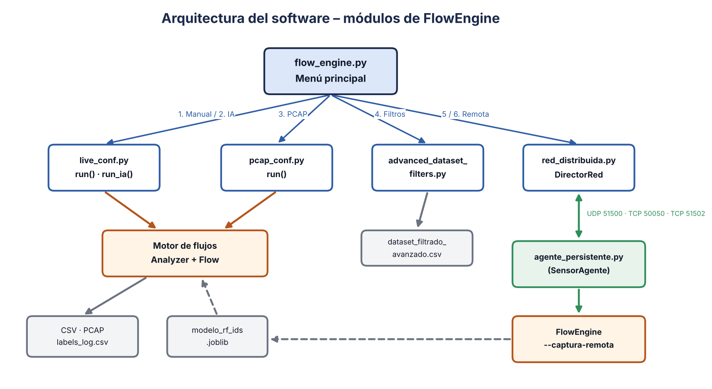
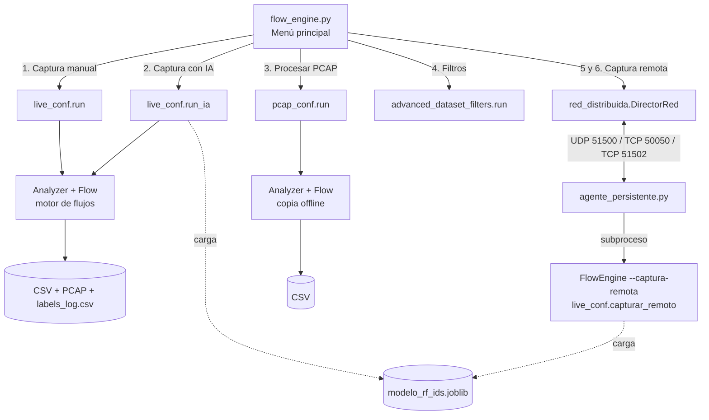
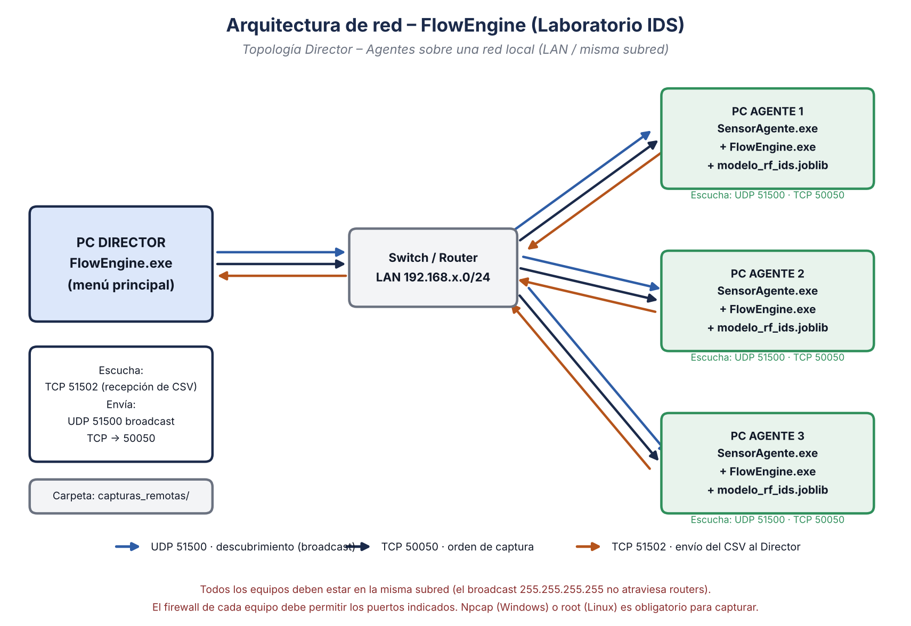
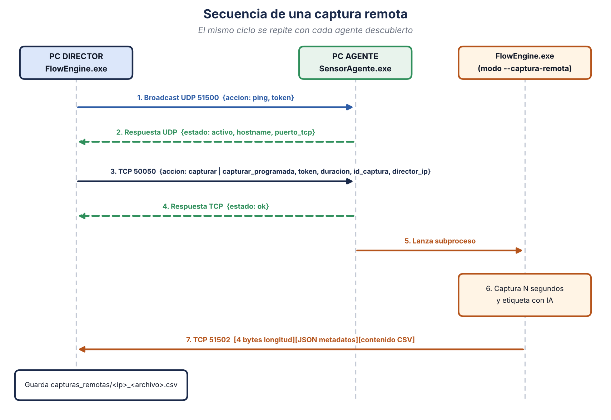
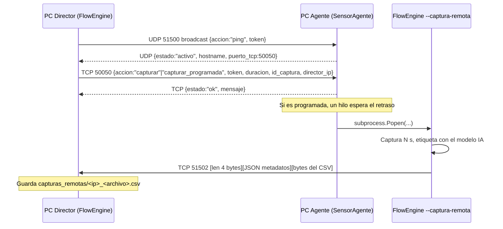

# Manual Técnico — FlowEngine (Generador de Datasets para IDS)

> **Versión del documento:** 1.1 · **Fecha:** noviembre de 2026  
> **English version:** [../en/technical_manual.md](../en/technical_manual.md)

---

## Tabla de contenido

1. [Introducción](#1-introducción)
2. [Requisitos del sistema](#2-requisitos-del-sistema)
3. [Estructura del proyecto](#3-estructura-del-proyecto)
4. [Arquitectura del software](#4-arquitectura-del-software)
5. [Arquitectura de red](#5-arquitectura-de-red)
6. [Descripción de los módulos](#6-descripción-de-los-módulos)
7. [Motor de flujos (Flow Engine)](#7-motor-de-flujos-flow-engine)
8. [Diccionario de datos del CSV](#8-diccionario-de-datos-del-csv)
9. [Integración con el modelo de IA](#9-integración-con-el-modelo-de-ia)
10. [Parámetros de configuración](#10-parámetros-de-configuración)
11. [Archivos generados](#11-archivos-generados)
12. [Compilación y despliegue](#12-compilación-y-despliegue)
13. [Seguridad](#13-seguridad)
14. [Problemas conocidos y mejoras recomendadas](#14-problemas-conocidos-y-mejoras-recomendadas)
15. [Solución de problemas](#15-solución-de-problemas)
16. [Herramientas complementarias](#16-herramientas-complementarias)

---

## 1. Introducción

**FlowEngine** es una herramienta de consola escrita en Python para **generar datasets de tráfico de red** orientados al entrenamiento y la evaluación de Sistemas de Detección de Intrusiones (IDS). El programa:

- Captura tráfico en vivo (o lee archivos `.pcap/.pcapng`) con **Scapy**.
- Agrupa los paquetes en **flujos bidireccionales** y genera **91 columnas** por flujo, de las cuales **64 son características numéricas** (estadísticas de tamaño y tiempo, flags TCP, TLS/JA3, DNS, HTTP, entropía, etc.).
- Etiqueta cada flujo **manualmente** (el operador escribe la etiqueta en vivo) o **automáticamente** con un modelo **Random Forest** previamente entrenado (`modelo_rf_ids.joblib`).
- Permite **filtrar y derivar variables** sobre el dataset resultante.
- Soporta **captura distribuida**: un PC *Director* descubre agentes (sensores) en la LAN, les ordena capturar (de inmediato o programado) y recibe los CSV resultantes.

### 1.1 Componentes ejecutables

| Ejecutable | Fuente | Rol |
|---|---|---|
| `FlowEngine.exe` | `flow_engine.py` (+ módulos) | Aplicación principal con menú. En el **Director** se usa de forma interactiva; en los **agentes** es lanzado en modo `--captura-remota`. |
| `SensorAgente.exe` | `agente_persistente.py` | Servicio residente sin consola que escucha órdenes de la red y lanza capturas. Solo se usa en los equipos **agente**. |

---

## 2. Requisitos del sistema

### 2.1 Sistema operativo

| SO | Soporte | Requisitos adicionales |
|---|---|---|
| Windows 10/11 (64 bits) | Principal | **Npcap** instalado en modo *WinPcap API-compatible*. Nmap opcional. Ejecutar como Administrador. |
| Linux (Debian/Ubuntu) | Soportado | Ejecutar con `sudo` (root). `tcpdump` y `nmap` (se instalan con `apt-get` automáticamente). |

### 2.2 Software para desarrollo

| Componente | Versión recomendada | Uso |
|---|---|---|
| Python | 3.10 – 3.12 | Intérprete |
| scapy | ≥ 2.5 | Captura y disección de paquetes |
| numpy | ≥ 1.24 | Estadísticas de flujo |
| pandas | ≥ 2.0 | Filtros avanzados y alineación de features del modelo |
| scikit-learn | **misma versión con la que se entrenó el modelo** | Predicción Random Forest |
| joblib | ≥ 1.3 | Carga del modelo |
| cryptography | ≥ 41 | Requerida por capas TLS de Scapy |
| tkinter | incluido con Python | Diálogos para seleccionar archivos/carpetas |
| PyInstaller | ≥ 6.0 | Compilación a ejecutable |

> ⚠️ El modelo `.joblib` debe cargarse con la **misma versión de scikit-learn** con la que fue entrenado; de lo contrario puede fallar o dar predicciones incorrectas.

### 2.3 Instalación automática de dependencias

Al ejecutarse como script (`.py`), `instalar_dependencias_python()` verifica con `importlib.util.find_spec` cada librería y la instala con `pip` si falta. En el ejecutable compilado (`sys.frozen`) este paso se omite, porque las librerías ya van empaquetadas.

`check_and_install_tools()` verifica las herramientas del sistema:

- **Windows:** busca `C:\Windows\System32\Npcap` y `C:\Program Files (x86)\Nmap\nmap.exe`. Si faltan, ejecuta `npcap-1.88.exe` / `nmap-7.99-setup.exe` ubicados **junto al ejecutable**.
- **Linux:** exige root (`os.geteuid() == 0`) e instala `nmap` y `tcpdump` vía `apt-get` si no existen.

---

## 3. Estructura del proyecto

```text
FlowEngine/
├── src/                          # Programa principal (todos los .py juntos)
│   ├── flow_engine.py            # Punto de entrada: menú principal y modo --captura-remota
│   ├── live_conf.py              # Captura en vivo (manual / IA / remota) + motor de flujos
│   ├── pcap_conf.py              # Procesamiento offline de archivos PCAP (mismo motor)
│   ├── advanced_dataset_filters.py  # Filtros y variables derivadas sobre un CSV
│   ├── red_distribuida.py        # Lado Director: descubrimiento, órdenes y recepción
│   ├── agente_persistente.py     # Lado Agente: servicio UDP/TCP que lanza capturas
│   └── compilar.py               # Compilación con PyInstaller
├── training/
│   └── entrenar_modelo.py        # Entrena modelo_rf_ids.joblib (Random Forest)
├── tools/
│   ├── etiquetar_con_ground_truth.py  # Etiqueta un CSV con el ground truth de UNSW-NB15
│   ├── generar_diagramas.py      # Regenera los diagramas de docs/img
│   └── build_pdfs.sh             # Regenera los PDF de docs/pdf
├── lab/
│   └── lab_attacks.sh            # Generador de tráfico de ataque para el laboratorio
├── legacy/                       # Versiones anteriores que ya no se usan
├── datasets/ · models/ · installers/   # Solo README: datos en Zenodo; modelo en GitHub Releases
└── docs/                         # Manuales ES/EN, diagramas y PDF
```

Los módulos de `src/` deben estar **en la misma carpeta**, porque `flow_engine.py` los importa directamente (`import live_conf`, etc.) y `compilar.py` busca los archivos en el directorio actual.

---

## 4. Arquitectura del software



<details>
<summary>Código Mermaid (editable)</summary>



</details>

### 4.1 Modos de ejecución de `flow_engine.py`

| Modo | Cómo se activa | Qué hace |
|---|---|---|
| Interactivo | `FlowEngine.exe` sin argumentos | `check_and_install_tools()` → `preparar_red_distribuida()` (abre el receptor TCP 51502) → `menu_principal()` |
| Captura remota | `FlowEngine.exe --captura-remota --duracion N --id ID --director-ip IP` | Lo invoca el agente. Ejecuta `red_distribuida.ejecutar_captura_y_reportar()` con `live_conf.capturar_remoto` y envía el CSV al Director. |

### 4.2 Modelo de concurrencia

| Hilo | Dónde | Función |
|---|---|---|
| Sniffer (principal) | `Analyzer.run()` | `scapy.sniff(prn=Analyzer.process)` |
| Teclado | `input_listener()` | Cambia la etiqueta actual o detiene la captura (`stop`/`salir`) |
| Reaper | `Analyzer._reaper_loop()` | Cada 5 s cierra flujos inactivos > `flow_timeout` |
| Auto-stop | `capturar_remoto.auto_stop()` | Detiene la captura remota tras `duracion` segundos |
| Receptor TCP | `DirectorRed.iniciar_receptor_reportes()` | Servidor en 51502; un hilo por archivo recibido |
| UDP / TCP agente | `agente_persistente.py` | Hilo de descubrimiento + servidor de comandos; un hilo por conexión |

El diccionario compartido `Analyzer.flows` está protegido por `threading.Lock()`.

---

## 5. Arquitectura de red

### 5.1 Topología



El sistema sigue un modelo **Director – Agentes** sobre una **misma red local**:

- **PC Director:** ejecuta `FlowEngine.exe` de forma interactiva. Descubre agentes, envía órdenes y recibe los CSV en la carpeta `capturas_remotas/`.
- **PC Agente (sensor):** ejecuta `SensorAgente.exe` en segundo plano. Junto a él deben estar `FlowEngine.exe` y `modelo_rf_ids.joblib`.

### 5.2 Puertos y protocolos

| Puerto | Protocolo | Escucha en | Dirección | Propósito |
|---|---|---|---|---|
| **51500** | UDP | Agente (`0.0.0.0`) | Director → broadcast `255.255.255.255` | Descubrimiento de agentes (ping / respuesta) |
| **50050** | TCP | Agente (`0.0.0.0`) | Director → Agente | Órdenes de captura (inmediata o programada) |
| **51502** | TCP | Director (`0.0.0.0`) | Agente → Director | Envío del archivo CSV resultante |

Constantes definidas en `red_distribuida.py` y `agente_persistente.py`:

```python
PUERTO_UDP_DESCUBRIMIENTO     = 51500
PUERTO_TCP_COMANDOS           = 50050   # agente_persistente.py
PUERTO_TCP_RECEPCION_REPORTES = 51502   # red_distribuida.py
TOKEN_RED                     = _cargar_token_red()
CARPETA_CAPTURAS_REMOTAS      = "capturas_remotas"
```

**Token de la red.** `_cargar_token_red()` (presente en ambos módulos) lo busca en este orden:

1. Variable de entorno `FLOWENGINE_TOKEN`.
2. Archivo `token_red.txt` junto al programa (`.py` o `.exe`), con el token en la primera línea.
3. Valor por defecto `MI_TOKEN_SECRETO_123` (público; solo para pruebas).

El Director y **todos** los agentes deben usar el mismo token.

### 5.3 Secuencia de una captura remota



<details>
<summary>Código Mermaid (editable)</summary>



</details>

### 5.4 Formato de los mensajes

**Descubrimiento (Director → broadcast, UDP 51500):**
```json
{"accion": "ping", "token": "MI_TOKEN_SECRETO_123"}
```

**Respuesta del agente (UDP, unicast al Director):**
```json
{"estado": "activo", "hostname": "PC-LAB-01", "puerto_tcp": 50050}
```
El Director espera respuestas durante **3 s** (`descubrir_agentes(tiempo_espera=3)`).

**Orden de captura (Director → Agente, TCP 50050):**
```json
{
  "accion": "capturar",            // o "capturar_programada"
  "token": "MI_TOKEN_SECRETO_123",
  "duracion": 60,
  "director_ip": "192.168.1.10",
  "id_captura": "prueba_01",
  "retraso_segundos": 3600,        // solo en capturar_programada
  "fecha_ejecucion": "2026-11-03 20:30"
}
```

**Transferencia del resultado (Agente → Director, TCP 51502):**

| Bytes | Contenido |
|---|---|
| 0 – 3 | Longitud *L* de los metadatos, entero sin signo big-endian (`struct.pack('>I', L)`) |
| 4 – 4+L | JSON `{"nombre_archivo": "remoto_<id>_<epoch>.csv", "tamano": <bytes>, "token": "<TOKEN_RED>"}` |
| resto | Contenido binario del CSV, enviado en bloques de 4096 bytes |

El Director rechaza la conexión si el token no coincide, limpia `nombre_archivo` (sin carpetas ni caracteres inválidos) y lo guarda como `capturas_remotas/<IP_agente>_<nombre_archivo>`. Si llegan menos bytes de los anunciados, lo informa como transferencia incompleta.

### 5.5 Requisitos de red

1. Todos los equipos en la **misma subred** (el broadcast `255.255.255.255` no atraviesa routers).
2. Relojes sincronizados (la captura programada calcula el retraso con la hora del **Director**).
3. Reglas de firewall de entrada:

**Windows (PowerShell como Administrador):**
```powershell
# En cada AGENTE
New-NetFirewallRule -DisplayName "FlowEngine UDP 51500" -Direction Inbound -Protocol UDP -LocalPort 51500 -Action Allow
New-NetFirewallRule -DisplayName "FlowEngine TCP 50050" -Direction Inbound -Protocol TCP -LocalPort 50050 -Action Allow
# En el DIRECTOR
New-NetFirewallRule -DisplayName "FlowEngine TCP 51502" -Direction Inbound -Protocol TCP -LocalPort 51502 -Action Allow
```

**Linux (ufw):**
```bash
sudo ufw allow 51500/udp && sudo ufw allow 50050/tcp   # agente
sudo ufw allow 51502/tcp                                # director
```

---

## 6. Descripción de los módulos

### 6.1 `flow_engine.py` — Punto de entrada

| Función | Descripción |
|---|---|
| `instalar_dependencias_python()` | Instala con pip las librerías faltantes (solo en modo script). |
| `check_and_install_tools()` | Verifica Npcap/Nmap (Windows) o root + nmap/tcpdump (Linux). |
| `preparar_red_distribuida()` | Crea `DirectorRed` y lanza el receptor TCP 51502 en un hilo daemon. |
| `ejecutar_modo_captura_remota()` | Parsea `--captura-remota --duracion --id --director-ip` y ejecuta la captura + envío. |
| `menu_principal()` | Bucle del menú (opciones 0–6). Cada opción se ejecuta dentro de `try/except` para que un error no cierre el programa. |

### 6.2 `live_conf.py` — Captura en vivo

| Función / clase | Descripción |
|---|---|
| `run()` | Captura con etiquetado **manual**. Pide ruta, nombre del CSV y del PCAP. Por defecto guarda en `<carpeta del programa>/Capturas`. |
| `run_ia()` | Igual que `run()` pero carga `modelo_rf_ids.joblib` y activa `MODO_ETIQUETADO = "modelo"`. Al terminar restaura el modo manual. |
| `capturar_remoto(duracion, ruta, id, nombre_pcap)` | Captura temporizada sin interacción, siempre con IA. Devuelve la ruta del CSV. |
| `input_listener()` | Hilo de teclado: nueva etiqueta → `flush_all_active()` + registro en `LABEL_LOG`. |
| `get_active_interface()` | Interfaz de la ruta por defecto (`conf.route.route("0.0.0.0")`). |
| `_sanitizar_nombre_archivo()` | Elimina rutas y caracteres inválidos; fuerza la extensión. |
| `_ruta_disponible()` | Si el archivo existe y está bloqueado (Excel, antivirus), usa un nombre alterno con sufijo de hora. |
| `cargar_modelo_ids()` / `_predecir_etiqueta()` | Carga y aplica el modelo (ver §9). |
| `analizar_tls_clienthello()` / `calcular_ja3()` | Parser de ClientHello TLS y huella JA3 (MD5, sin valores GREASE). |
| `_entropia()` | Entropía de Shannon del payload (0–8 bits/byte). |
| `detectar_protocolo()` / `detectar_service_y_payload()` | Clasificación de protocolo y servicio + metadatos DNS/HTTP/TLS. |
| `Flow` | Acumula estadísticas de un flujo y genera la fila del CSV (`compute()`). |
| `Analyzer` | Gestiona flujos activos, escritura de CSV/PCAP, reaper y log de etiquetas. |

### 6.3 `pcap_conf.py` — Procesamiento offline

Contiene una copia del motor (`Flow`, `Analyzer`, parsers) adaptada a lectura de archivos. `run()` abre un diálogo para elegir el `.pcap/.pcapng`, otro para la carpeta de salida, pide el nombre del CSV (por defecto `pcap_resultado1.csv`) y procesa los paquetes con `PcapReader` (streaming, sin cargar el archivo completo en memoria), mostrando el progreso cada 10 000 paquetes. No genera PCAP de salida (`save_pcap: False`) y **el CSV resultante no incluye la columna `Label`** (no hay etiquetado en modo offline).

> Nota: al existir dos copias del motor (`live_conf.py` y `pcap_conf.py`), cualquier cambio en las features debe replicarse en ambas para que los datasets sean comparables.

### 6.4 `advanced_dataset_filters.py` — Filtros

| Función | Descripción |
|---|---|
| `seleccionar_dataset()` | Diálogo Tkinter para elegir un CSV. |
| `convertir_columnas_numericas()` | Convierte a numérico solo las columnas en las que **todos** los valores no vacíos son números; las de texto (`State`, `Service`, `JA3`, `HTTP *`…) se conservan. |
| `traducir_filtro()` | Traduce sintaxis tipo Wireshark a `pandas.query`: `tcp`, `udp`, `&&`→`and`, `\|\|`→`or`, `ip.src`, `ip.dst`. `tcp.port == N` / `udp.port == N` equivale a *protocolo y (puerto origen o destino) = N*, como en Wireshark (admite `== != > < >= <=`). |
| `crear_variable()` | Crea una columna con `df.eval(expresión)`. |
| `aplicar_filtro()` | Aplica el filtro y muestra las filas restantes. |
| `guardar_dataset()` | Guarda `dataset_filtrado_avanzado.csv` en la carpeta del CSV original. |

### 6.5 `red_distribuida.py` — Lado Director

| Elemento | Descripción |
|---|---|
| `obtener_ip_local()` | Determina la IP de la interfaz de salida (socket UDP hacia 8.8.8.8, sin enviar datos). |
| `DirectorRed.descubrir_agentes()` | Broadcast UDP y recolección de respuestas durante 3 s. |
| `DirectorRed.enviar_orden_captura()` | Envía la orden JSON por TCP (timeout 10 s). |
| `DirectorRed.iniciar_receptor_reportes()` | Servidor TCP 51502 (`listen(10)`), un hilo por conexión. |
| `DirectorRed.manejar_recepcion_archivo()` | Lee longitud + metadatos + contenido, valida el token, sanea el nombre y guarda el archivo. |
| `menu_captura_instantanea()` | Opción 6 del menú. |
| `menu_programar_captura()` | Opción 5 del menú. Valida fecha `YYYY-MM-DD HH:MM` (24 h) y que sea futura. |
| `ejecutar_captura_y_reportar()` | Lado agente: ejecuta la captura y envía el CSV al Director (timeout 30 s). |

### 6.6 `agente_persistente.py` — Servicio del agente

- Fija el directorio de trabajo en la carpeta del ejecutable y registra la actividad en `sensor_agente.log`.
- **Hilo UDP (51500):** responde a `ping` con token válido.
- **Servidor TCP (50050):** valida el token y atiende `capturar` (inmediata) o `capturar_programada` (hilo que espera `retraso_segundos` y luego lanza la captura).
- `iniciar_motor_captura()` lanza `FlowEngine.exe` (Windows) o `FlowEngine` (Linux) con `--captura-remota ...` (o `python flow_engine.py ...` en modo script) con `subprocess.Popen`.
- Compilado con `--noconsole`: no muestra ventana; se detiene desde el Administrador de tareas.

### 6.7 `compilar.py` — Compilación

Verifica/instala PyInstaller, borra `build/`, `dist/` y los `.spec` previos, y compila:

| Salida | Comando PyInstaller |
|---|---|
| `dist/FlowEngine(.exe)` | `--onefile --clean --name FlowEngine flow_engine.py` |
| `dist/SensorAgente(.exe)` | `--onefile --clean --noconsole --name SensorAgente agente_persistente.py` |

---

## 7. Motor de flujos (Flow Engine)

### 7.1 Identificación del flujo

Cada paquete se asigna a un flujo mediante la **5-tupla** `(IP origen, IP destino, puerto origen, puerto destino, protocolo)`. Se busca también la tupla inversa para tratar el flujo como **bidireccional** (`FWD` = sentido del primer paquete, `BWD` = respuesta).

- Sin capa IP: se usan direcciones 802.11 (`addr2/addr1`) o MAC Ethernet.
- ICMP: se usa el `id` del echo como pseudo-puerto, para no mezclar pings distintos entre el mismo par de hosts.
- Protocolos detectados: `TCP`, `UDP`, `ICMP`, `ARP`, `IP`, `802.11_Beacon/Auth/Deauth/ProbeReq/Other`, `OTHER`.

### 7.2 Ciclo de vida (cuándo se escribe una fila)

Un flujo se cierra y se escribe en el CSV cuando ocurre lo primero de:

1. Alcanza `min_packets` (5) paquetes en total.
2. Es **terminal**: se vio RST, o FIN en ambos sentidos.
3. Supera `flow_timeout` (30 s) sin tráfico (lo revisa el *reaper* cada 5 s).
4. El operador **cambia la etiqueta** (se cierran todos los flujos activos con la etiqueta anterior).
5. Se **detiene** la captura (flush final).

> **Consideración de diseño:** como el cierre ocurre al llegar a `min_packets`, una conexión larga genera **varias filas consecutivas** (ventanas de ~5 paquetes) y no una sola fila por conexión. Ajuste `min_packets` si necesita flujos completos.

### 7.3 Estado TCP

Se registra un estado por paquete y la columna `State` toma el **más frecuente**: `S0` (SYN), `S1` (SYN-ACK), `EST` (ACK), `FIN`, `RST`. Para UDP/ICMP: `CON` si hubo respuesta, `INT` si no.

### 7.4 Detección de servicio

Orden de prioridad: DNS (capa Scapy) → HTTP (capa Scapy) → puerto conocido (el menor de los dos puertos) → TLS por firma (`0x16`) → `other`.

Puertos mapeados: 21 ftp, 22 ssh, 23 telnet, 25 smtp, 53 dns, 80 http, 110 pop3, 123 ntp, 137/138 netbios, 139/445 smb, 143 imap, 443 https, 1433 mssql, 1883 mqtt, 1900 ssdp, 3306 mysql, 3389 rdp, 5432 postgresql.

### 7.5 Firmas de escaneo

`Flag Signature` marca `null_scan` (sin flags), `xmas_scan` (FIN+PSH+URG) o `fin_scan` (solo FIN); en otro caso `none`.

---

## 8. Diccionario de datos del CSV

| Grupo | Columnas | Descripción |
|---|---|---|
| Identificación | `Start Time`, `End Time`, `Source IP`, `Destination IP`, `Source Port`, `Destination Port`, `Protocol`, `State`, `Service`, `SNI` | Hora `HH:MM:SS.ffffff`, 5-tupla, estado, servicio y SNI TLS |
| Volumen | `Flow Duration`, `Src Bytes`, `Dst Bytes`, `Src Packets`, `Dst Packets`, `Flow Bytes/s`, `Flow Packets/s`, `Src Load`, `Dst Load`, `Bytes Per Pkt`, `Size Diff`, `Byte Ratio` | Duración (s), bytes/paquetes por sentido y tasas |
| TTL | `Src TTL`, `Dst TTL`, `Src TTL Var`, `Dst TTL Var` | Media y varianza del TTL por sentido |
| Tiempos | `Sjit`, `Djit`, `Sintpkt`, `Dintpkt`, `Fwd IAT Min`, `Fwd IAT Max`, `Bwd IAT Min`, `Bwd IAT Max`, `Active Mean`, `Idle Mean` | Jitter, tiempo entre paquetes y periodos activo/inactivo (`active_gap` = 1 s) |
| TCP handshake | `tcprtt`, `synack` | SYN→ACK y SYN→SYN-ACK (s) |
| Contexto (ventana 60 s) | `ct_srv_src`, `ct_srv_dst`, `ct_dst_ltm`, `ct_src_ltm` | Conteo de flujos recientes por origen/destino/servicio (estilo UNSW-NB15) |
| Flags TCP | `SYN Count`, `ACK Count`, `FIN Count`, `RST Count`, `PSH Count`, `URG Count`, `ECE Count`, `CWR Count`, `Fwd/Bwd PSH Count`, `Fwd/Bwd URG Count`, `Flag Signature` | Conteo de flags y firma de escaneo |
| Tamaños | `Pkt Size Mean`, `Pkt Size Var`, `First Pkt Size`, `Fwd/Bwd Pkt Len Min/Max/Mean/Std` | Estadísticas de longitud de paquete |
| Ventana / retransmisión | `Init Fwd Win`, `Init Bwd Win`, `Zero Window Count`, `Fwd Retrans`, `Bwd Retrans` | Ventana TCP inicial, ventanas cero y retransmisiones (mismo `seq` con payload) |
| IP | `Frag Count`, `DF Count` | Fragmentos y paquetes con *Don't Fragment* |
| Contenido | `Payload Entropy Mean` | Entropía media del payload (≈7–8 sugiere cifrado/comprimido) |
| ICMP | `ICMP Type`, `ICMP Code` | Primer valor visto |
| DNS | `DNS Qname`, `DNS Qtype`, `DNS Rcode`, `DNS Ancount`, `DNS Qname Len`, `DNS Qname Entropy` | Útil para detectar DGA/túneles DNS |
| HTTP | `HTTP Method`, `HTTP Host`, `HTTP URI`, `HTTP User-Agent`, `HTTP Status`, `HTTP Content-Length` | Solo HTTP sin cifrar |
| TLS | `TLS Version`, `JA3` | Versión del ClientHello y huella JA3 |
| Clase | `Label` | Etiqueta manual o predicha por el modelo (no existe en los CSV generados por `pcap_conf.py`) |

Los campos no aplicables quedan vacíos (no en 0), para no confundirlos con un valor real.

---

## 9. Integración con el modelo de IA

- **Archivo:** `modelo_rf_ids.joblib`, buscado **en la misma carpeta que el programa** (nunca se pide la ruta).
- **Requisito:** el modelo debe exponer `feature_names_in_`, lo que ocurre cuando se entrena con un `pandas.DataFrame`.
- **Alineación:** para cada flujo se construye un DataFrame con las columnas de `feature_names_in_` en ese orden. Las columnas inexistentes o de texto (IPs, servicio, etc.) se rellenan con **0**.
- **Resultado:** la predicción (`str`) se escribe en `Label`. Valores especiales en caso de fallo: `sin_pandas`, `sin_prediccion`, `error_prediccion`.

**Entrenamiento:** usa [`training/entrenar_modelo.py`](../../training/entrenar_modelo.py):

```bash
python training/entrenar_modelo.py --datos datasets --salida training/modelo_salida
```

El script une todos los CSV de la carpeta, normaliza las etiquetas (`MAPA_ETIQUETAS`), descarta columnas no numéricas (IPs, servicio…), busca hiperparámetros con `RandomizedSearchCV` (15 combinaciones × validación cruzada estratificada de 3 particiones) y guarda:

| Archivo | Contenido |
|---|---|
| `modelo_rf_ids.joblib` | Modelo final |
| `columnas_features.json` | Lista y orden de las variables usadas |
| `matriz_confusion.png` | Matriz de confusión del conjunto de prueba |
| `importancia_caracteristicas.png` / `.csv` | Importancia de cada variable |

Como se entrena con un DataFrame cuyas columnas tienen los mismos nombres que genera FlowEngine, el modelo resultante es compatible directamente con `_predecir_etiqueta()`.

---

## 10. Parámetros de configuración

Diccionario `CONFIG` (en `live_conf.py` y `pcap_conf.py`):

| Clave | live_conf | pcap_conf | Descripción |
|---|---|---|---|
| `csv_file` | `live_resultado.csv` | `pcap_resultado1.csv` | Nombre por defecto del CSV |
| `min_packets` | 5 | 5 | Paquetes para cerrar un flujo |
| `time_window` | 60 | 60 | Ventana (s) de las features `ct_*` |
| `flow_timeout` | 30 | 30 | Inactividad (s) para cerrar un flujo |
| `active_gap` | 1.0 | 1.0 | Hueco (s) que separa periodo activo de inactivo |
| `save_pcap` | `True` | `False` | Guardar tráfico crudo en `.pcap` |
| `pcap_file` | `captura.pcap` | — | Nombre por defecto del PCAP |

---

## 11. Archivos generados

| Archivo | Dónde | Contenido |
|---|---|---|
| `<nombre>.csv` | Carpeta elegida (por defecto `Capturas/`) | Dataset de flujos |
| `<nombre>.pcap` | Igual | Tráfico crudo (escritura `sync=True`, no se pierde ante cierres abruptos) |
| `labels_log.csv` | Igual | `timestamp_unix, timestamp_legible, label` de cada cambio de etiqueta |
| `filas_no_guardadas.csv` | Igual | Filas que no se pudieron escribir tras 5 reintentos (CSV bloqueado) |
| `dataset_filtrado_avanzado.csv` | Carpeta del CSV filtrado | Resultado de la opción 4 |
| `capturas_remotas/<ip>_remoto_<id>_<epoch>.csv` | Director | CSV recibido de cada agente |
| `capturas_remotas/remoto_<id>_<epoch>.pcap` | Agente | PCAP local de la captura remota (no se envía) |
| `sensor_agente.log` | Agente | Log del servicio |

---

## 12. Compilación y despliegue

### 12.1 Compilar

```bash
cd src
pip install -r ../requirements.txt
python compilar.py
```

Resultado en `src/dist/`: `FlowEngine(.exe)` y `SensorAgente(.exe)`. En Linux: `chmod +x dist/*`.

> PyInstaller no hace compilación cruzada: compile en Windows para obtener `.exe` y en Linux para binarios Linux.

### 12.2 Paquete de distribución

**PC Director:**
```text
FlowEngine.exe
modelo_rf_ids.joblib      (opcional, solo para la opción 2)
npcap-1.88.exe            (instalador, descargado de npcap.com)
nmap-7.99-setup.exe       (opcional)
token_red.txt             (recomendado: el mismo token en todos los equipos)
```

**PC Agente:**
```text
SensorAgente.exe
FlowEngine.exe            (obligatorio: el agente lo lanza)
modelo_rf_ids.joblib      (obligatorio: la captura remota siempre usa IA)
npcap-1.88.exe
token_red.txt             (recomendado: el mismo token que el Director)
```

### 12.3 Inicio automático del agente (opcional)

- **Windows:** crear una tarea en el Programador de tareas con "Ejecutar con los privilegios más altos" y disparador "Al iniciar sesión", o colocar un acceso directo en `shell:startup` (requiere que el usuario sea administrador para capturar).
- **Linux (systemd):**
```ini
# /etc/systemd/system/sensoragente.service
[Unit]
Description=FlowEngine SensorAgente
After=network-online.target
[Service]
WorkingDirectory=/opt/flowengine
ExecStart=/opt/flowengine/SensorAgente
Restart=on-failure
User=root
[Install]
WantedBy=multi-user.target
```

---

## 13. Seguridad

| Riesgo | Detalle | Recomendación |
|---|---|---|
| Token por defecto público | Si no se configura, se usa `MI_TOKEN_SECRETO_123`, visible en GitHub | ✅ Ahora se lee de `FLOWENGINE_TOKEN` o `token_red.txt` (excluido por `.gitignore`). Configúrelo en todos los equipos |
| Tráfico sin cifrar | Órdenes, token y CSV viajan en texto plano | Usar solo en redes de laboratorio aisladas o añadir TLS (módulo `ssl`) |
| Receptor sin autenticación | El puerto 51502 aceptaba archivos de cualquier equipo | ✅ Corregido: los metadatos llevan el token y el Director lo valida |
| Nombre de archivo no saneado | `nombre_archivo` viene del cliente | ✅ Corregido: `_nombre_seguro()` elimina carpetas y caracteres inválidos |
| Ejecución con privilegios | La captura requiere admin/root | Ejecutar solo en equipos de laboratorio |
| Datos sensibles | Los PCAP/CSV pueden contener IPs, dominios, URIs y user-agents reales | No subir capturas reales al repositorio (ver `.gitignore`) |

> **Uso ético:** capture tráfico solo en redes propias o con autorización expresa.

---

## 14. Problemas conocidos y mejoras recomendadas

### 14.1 Corregidos en la versión 1.1

| # | Problema | Ubicación | Efecto que tenía | Corrección aplicada |
|---|---|---|---|---|
| 1 | Clave de retraso inconsistente: el Director enviaba `retraso_segundos` y el agente leía `delay_segundos` | `agente_persistente.manejar_conexion` | Toda captura programada empezaba a los 60 s, no a la hora elegida | El agente lee `retraso_segundos` (acepta `delay_segundos` por compatibilidad) |
| 2 | Nombre del binario fijo `FlowEngine.exe` | `agente_persistente.iniciar_motor_captura` | En Linux compilado el agente no encontraba el motor | `FlowEngine.exe` en Windows, `FlowEngine` en Linux |
| 3 | `tcp.port` / `udp.port` se traducían mal (`Protocol == 'TCP'.port == 80`) | `advanced_dataset_filters.traducir_filtro` | Error de sintaxis al filtrar por puerto | Se traducen antes que `tcp`/`udp` y comparan puerto origen o destino |
| 4 | `convertir_columnas_numericas` vaciaba columnas de texto | `advanced_dataset_filters` | `Start/End Time`, `State`, `Service`, `Flag Signature`, `DNS Qname`, `HTTP *` quedaban vacías en el CSV filtrado | Solo se convierten columnas totalmente numéricas |
| 5 | Ejemplos con la columna inexistente `Packet Length Mean` | `advanced_dataset_filters` | Confundía al usuario | Ejemplos con `Pkt Size Mean` / `Fwd Pkt Len Max` |
| 6 | Token fijo, receptor sin autenticación y nombre de archivo sin sanear | `red_distribuida`, `agente_persistente` | Ver §13 | Token configurable, validado en la recepción; nombre saneado; lectura exacta de metadatos |
| 7 | Rutas `D:\Descargas\...` fijas | `training/entrenar_modelo.py`, `tools/etiquetar_con_ground_truth.py` | Solo funcionaban en el equipo original | Parámetros `--datos/--salida` y `--csv/--gt/--salida` |

### 14.2 Pendientes (mejoras recomendadas)

| # | Problema | Ubicación | Efecto | Sugerencia |
|---|---|---|---|---|
| 8 | Motor duplicado | `live_conf.py` y `pcap_conf.py` | Riesgo de divergencia entre datasets | Extraer `Flow`/`Analyzer` a un módulo común |
| 9 | El PCAP remoto no se envía al Director | `ejecutar_captura_y_reportar` | Solo llega el CSV | Enviar también el `.pcap` si se requiere |
| 10 | `Start Time`/`End Time` sin fecha | `Flow.compute` | Ambigüedad en capturas que cruzan medianoche | Incluir fecha o epoch |
| 11 | Los CSV de `pcap_conf.py` no tienen `Label` | `pcap_conf.Flow.compute` | Hay que etiquetar a posteriori | Opción de etiqueta fija o con modelo |
| 12 | Comunicación sin cifrar | `red_distribuida`, `agente_persistente` | Token y datos legibles en la red | TLS con el módulo `ssl` |

---

## 15. Solución de problemas

| Síntoma | Causa probable | Solución |
|---|---|---|
| `ERROR CRÍTICO DE RED: SCAPY NO DETECTA NPCAP` | Npcap recién instalado o sin modo WinPcap | Reiniciar el programa; si persiste, reinstalar Npcap marcando *WinPcap API-compatible Mode* |
| `No se detectaron agentes en la red` | Agente apagado, firewall o subred distinta | Verificar `SensorAgente.exe` en el Administrador de tareas, abrir UDP 51500, misma subred |
| `Fallo de conexión con <ip>` | TCP 50050 bloqueado | Regla de firewall en el agente |
| El Director no recibe el CSV | TCP 51502 bloqueado o la IP del Director cambió | Regla de firewall en el Director; revisar `sensor_agente.log` |
| `Archivo rechazado de <ip>: token inválido` | El agente y el Director usan tokens distintos | Mismo `token_red.txt` (o `FLOWENGINE_TOKEN`) en todos los equipos |
| `No se encontró el modelo IA` | Falta `modelo_rf_ids.joblib` junto al ejecutable | Copiarlo a la carpeta del programa (y del agente) |
| `Label = error_prediccion` | Versión de scikit-learn distinta o features no compatibles | Reentrenar con los nombres de columna de FlowEngine |
| `'archivo' está en uso` | CSV abierto en Excel | Cerrarlo; el programa usa automáticamente un nombre alterno |
| Linux: `necesitas permisos de root` | Ejecución sin sudo | `sudo ./FlowEngine` |

---

## 16. Herramientas complementarias

| Herramienta | Uso |
|---|---|
| [`training/entrenar_modelo.py`](../../training/entrenar_modelo.py) | Entrena `modelo_rf_ids.joblib` (§9). |
| [`tools/etiquetar_con_ground_truth.py`](../../tools/etiquetar_con_ground_truth.py) | Etiqueta un CSV generado desde un PCAP de UNSW-NB15 cruzándolo con `NUSW-NB15_GT.csv` por la 4-tupla (IPs y puertos). Añade `attack_cat` y `label` (0/1). Uso: `python tools/etiquetar_con_ground_truth.py --csv flujos.csv --gt NUSW-NB15_GT.csv --salida etiquetado.csv` (requiere `tqdm`). |
| [`lab/lab_attacks.sh`](../../lab/lab_attacks.sh) | Genera el tráfico de ataque del laboratorio (nmap, hydra, hping3, slowloris, ffuf, sqlmap, bettercap) y pausa antes de cada ataque para que el operador cambie la etiqueta en FlowEngine. **Solo en un laboratorio aislado y propio.** Ver [lab/README.md](../../lab/README.md). |
| [`tools/generar_diagramas.py`](../../tools/generar_diagramas.py) · [`tools/build_pdfs.sh`](../../tools/build_pdfs.sh) | Regeneran los diagramas y los PDF de esta documentación. |
